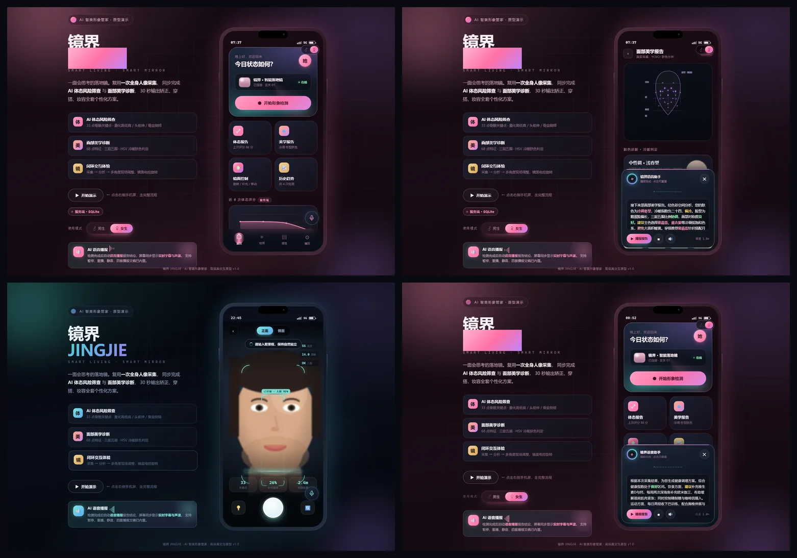
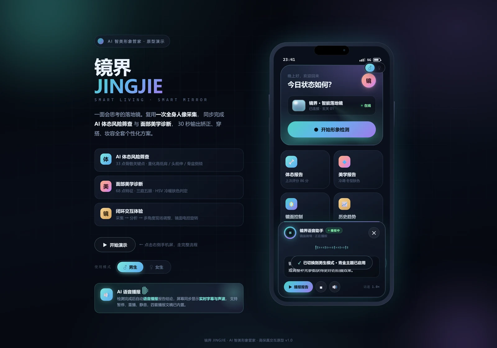
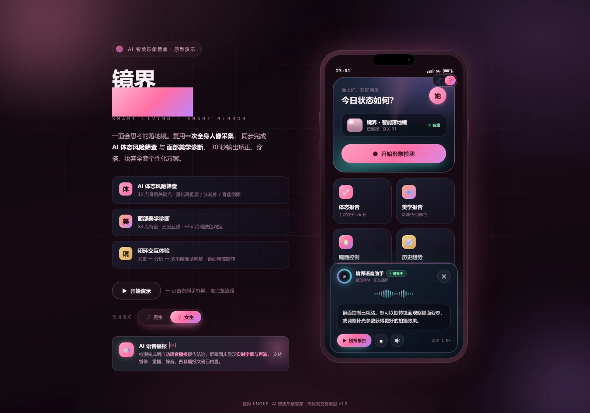

<div align="center">

# 镜界 JINGJIE

### AI 智美形象管家 · 高保真交互原型

**一面会思考的落地镜**

一次全身人像采集，同步完成 **AI 体态风险筛查** + **面部美学诊断**，
输出体态矫正、穿搭配色、妆容理容、饮食运动作息全套个性化方案。

<br>

[](#后端服务)
[](#后端服务)
[](#技术栈)
[](#技术栈)
[](#版本记录)
[](#许可)

<br>



<sub>后端在线首页（数据源胶囊） · 实时人脸跟踪采集 · 服务端方案报告 · 女生粉色主题</sub>

<br>

**[🚀 快速开始](#-快速开始)** &nbsp;·&nbsp;
**[🖥️ 后端服务](#-后端服务)** &nbsp;·&nbsp;
**[📸 截图总览](gallery.html)** &nbsp;·&nbsp;
**[🧠 算法细节](#-核心算法)** &nbsp;·&nbsp;
**[🎨 双主题](#-男生--女生双主题)**

</div>

---

## ✨ 这是什么

镜界是一整套「智能落地镜」产品的高保真**软件原型**。硬件侧为电控旋转底座 + 环形补光 + 高清摄像头 + 实木收纳镜背；本仓库实现的是其中的**软件交互与 AI 分析链路**，可直接在浏览器运行。

它**不是 PPT 里的静态图**，而是一个能跑起来的**全栈应用**：

- 🎥 **真的打开摄像头**，用 `getUserMedia` 实时采集
- 🔌 **支持多摄像头 / USB 设备** —— 一键列出所有视频输入设备（内置 + 外接 USB），点名切换、热插拔自动刷新，外接设备拔掉自动回落
- 🧮 **真的做像素级分析** —— YCbCr 肤色检测、人脸包围盒投影、拉普拉斯清晰度、冷暖色调判定，全部由数学计算得出，**同一用户在不同光照下结果不同**
- 🔄 **每次测评都不一样** —— 种子化变化引擎让分数、健康分、建议组合每次都不同，且波动幅度严格受限、同 seed 可复现
- 🐍 **真的有后端** —— Python 标准库实现的 REST API 服务，SQLite 持久化检测历史与用户档案
- 🗣️ **真的会说话** —— Web Speech API 中文语音播报 + 实时打字机字幕
- 🎨 **一键换肤** —— 男生/女生双主题，零重载切换整套配色与文案
- 📦 **零第三方依赖** —— 前端无框架无构建，后端只用 Python 标准库，**整条链路不装一个 pip 包**

---

## 🚀 快速开始

### 方式一：带后端完整运行（推荐）

只需本机装有 **Python 3.8+**（无需 pip 安装任何包）：

```bash
git clone https://github.com/jhlking/MirrorVerse-SmartHome.git
cd MirrorVerse-SmartHome
python server.py
```

浏览器会自动打开 **http://127.0.0.1:8899/**。这一条命令同时做了三件事：

1. 启动 Python 后端（REST API + SQLite）
2. 托管前端静态资源（同源，摄像头可直接授权）
3. 首次运行自动写入 3 条演示数据

> 常用参数：`--port 9000` 换端口 · `--host 0.0.0.0` 局域网可访问 · `--reset` 清库重来 · `--no-browser` 不自动开浏览器

### 方式二：纯前端静态运行

不需要后端也能完整体验 —— 前端检测不到 API 会**自动降级**为本地规则引擎 + `localStorage`，功能一个不少，仅在首页标注「本地模式」。

```bash
python -m http.server 8899
# 或任意静态服务器：npx serve / php -S / VS Code Live Server
```

<details>
<summary><b>其他打开方式</b></summary>

| 方式 | 说明 |
|---|---|
| 双击 `index.html` | 直接 `file://` 打开，**摄像头不可用**，自动降级为剪影演示模式；后端若在运行仍可跨源连接 |
| 双击 `gallery.html` | 28 张演示截图总览，无需服务 |
| `python server.py` | **推荐**：前后端同源，摄像头 + 数据库全可用 |

</details>

> 💡 **没有摄像头？** 用 Edge/Chrome 的假摄像头参数也能跑通全链路：
> ```
> msedge --use-fake-ui-for-media-stream --use-fake-device-for-media-stream ^
>        --use-file-for-fake-video-capture=fakeface.y4m
> ```
> 仓库内附 `fakeface.y4m`（合成人像测试素材）。

---

## 🗺️ 交互流程

```
       ┌─────────┐   点击     ┌──────────┐  自动   ┌──────────┐
       │  首页   │ ─────────→ │  拍摄页  │ ──────→ │  分析中  │
       │  欢迎   │  开启摄像头 │ 实时取景 │  快门   │  进度条  │
       └─────────┘            └──────────┘         └────┬─────┘
                                                          │ 自动跳转
                            ┌─────────────────────────────┴──────────┐
                            ↓                                        ↓
                    ┌───────────────┐                      ┌─────────────────┐
                    │   体态报告    │ ──→ ┌──────────────┐ │   健康调理方案  │
                    │  评分 + 风险  │     │  面部美学报告 │ │ 饮食/运动/作息  │
                    └───────────────┘     │ 肤色/脸型/配色│ └─────────────────┘
                                          └──────────────┘
                            ┌───────────────────────┐
                            │      镜面控制         │  电控旋转底座 / 角度调节
                            └───────────────────────┘
```

7 个页面均为单页应用内的「手机屏」，带入场动画与页面过渡。

---

## 🧠 核心算法

全部为纯前端实现，无机器学习依赖。以下代码逻辑均在 `camera.js` / `advisor.js` 中。

<table>
<tr><th width="22%">模块</th><th>方法</th></tr>

<tr><td><b>肤色检测</b></td><td>

**YCbCr 阈值法** + RGB 关系约束，排除木质/暖色墙面误检
```
Cb = -0.169R - 0.331G + 0.500B + 128    要求 77 ≤ Cb ≤ 127
Cr =  0.500R - 0.419G - 0.081B + 128    要求 133 ≤ Cr ≤ 173
约束：R > G、R > B、max-min ≥ 12、60 < R ≤ 250
```
</td></tr>

<tr><td><b>人脸包围盒</b></td><td>

肤色像素**列/行投影** → 各取累积 5%~95% 主区间（抗噪）→ 归一化。
有效性校验：肤色占比 1.2%~65%，且不能横纵同时占满 96%。
</td></tr>

<tr><td><b>冷暖判定</b></td><td>

```
hueScore = (平均色相 - 25) × 1.8
rbScore  = (平均R-B - 38) × 0.9        典型中性肤色 R-B ≈ 38
冷暖指数  = clamp((hueScore + rbScore) / 2, -50, +50)
≤ -12 冷调 ／ ≥ +12 暖调 ／ 其余 中性调
```
</td></tr>

<tr><td><b>质量评估</b></td><td>

亮度（灰度均值）、对比度（灰度标准差）、**清晰度（拉普拉斯方差，4 邻域）**、暗部/高光占比。
</td></tr>

<tr><td><b>多帧融合</b></td><td>

快门连抓 5 帧，对肤色 RGB / 明度 / 饱和度 / 冷暖指数**取中位数**，抗单帧抖动。
</td></tr>

<tr><td><b>实时跟踪</b></td><td>

`startLoop()` 以 8 fps 抽 160×120 低分辨率帧做肤色投影，CSS 0.35 插值平滑跟随绘制检测框。
</td></tr>

</table>

### 建议规则引擎

```
肤色冷暖 ──┬─→ 配色知识库 PALETTES{cool, neutral, warm}
           │     → 主色色卡 / 规避色 / 金属 / 唇色 / 眼影 / 发色
           └─→ 明度 + 饱和度 → 四季细分（春 / 夏 / 秋 / 冬型）

脸型比例 ──┬─→ FACE_ADVICE   {鹅蛋/圆/长形/方/横长}  （女生：发型 / 配饰 / 妆容）
           └─→ FACE_ADVICE_M {鹅蛋/圆/长形/方/横长}  （男生：发型 / 配饰 / 修饰）

性别 ────────→ 妆容分支（唇色 / 眼影） 或 理容分支（护肤 / 胡须 / 眉形）

体态偏移 ──→ POSTURE_DIET{forward_head, shoulder, pelvis}
           → 饮食（维D+钙 / Omega-3 / 控糖控咖啡因）
           → 运动（收下巴 / 胸椎伸展 / 肩胛稳定）
           → 作息（屏幕齐眼 / 每小时起身 / 23:30 前入睡）

环境质量 ──→ 补光 / 距离 / 对比度 实拍诊断
```

---

## 🎨 男生 / 女生双主题

一键切换整套视觉与文案，**同一个页面零重载换肤**。所有颜色收敛为 CSS 变量，主题只是变量覆盖：

```css
:root[data-gender="male"]   { --c-accent: #7ee8dd;  /* 青 */  --c-bg: #05070d; }
:root[data-gender="female"] { --c-accent: #ff8fb8;  /* 玫瑰粉 */ --c-bg: #0d060c; }
```

<table>
<tr>
<td width="50%" align="center">

**男生 · 青主题**
<br>


</td>
<td width="50%" align="center">

**女生 · 粉主题**
<br>


</td>
</tr>
</table>

**切换入口**（两处，共用 `J.setGender()`）：

| 位置 | 控件 |
|---|---|
| 左侧品牌区 | `.gs-seg` 分段开关「♂ 男生 / ♀ 女生」 |
| 手机屏内右上 | `.gender-pill` 图标胶囊 |

**同步改变的内容**：

- **配色** — 舞台光晕、极光背景、手机金属边框（转玫瑰金）、头像、主按钮、卡片描边、文字色系
- **图标文字** — 头像字样 `镜` ⇄ `她`；报告区块标题 `妆容` ⇄ `理容`；图标 `💄` ⇄ `🧔`
- **建议文案** — 女生输出唇色/眼影/发色色号；男生输出护肤/胡须/眉形要点
- **持久化** — 写入 `localStorage['jingjie.gender']`，刷新保持；也支持 `?gender=female` URL 参数

> 性别主题**只改变配色与建议措辞，不改变分析算法**（肤色与脸型判定与性别无关）。

---

## 🔌 多摄像头 / USB 设备切换

落地镜常配外接 USB 摄像头（如罗技 BRIO、C920），而笔记本又自带内置摄像头 —— 镜界支持**任意视频输入设备的枚举、点选与热插拔切换**。

- **设备面板** — 拍摄页点右侧 🔄 打开，列出全部 `videoinput` 设备；🔌 表示外接 / USB、📷 表示内置，当前设备带高亮圆点
- **智能分类** — 浏览器给的 `label` 五花八门，这里用「内置排除词优先 + 外接关键词」双向判定：
  - 先拦内置强信号（`Integrated` / `Built-in` / `FaceTime` / `IR Camera` / `RealSense`…）
  - 再认外接关键词（`USB` / `UVC` / `Webcam` / `BRIO` / `C920` / `OBSBOT` / `LifeCam`…）
  - 名称自动清洗尾部厂商号 `(0bda:5844)`，面板只显示可读型号名
- **点名切换** — 点击任一设备即停流重连到目标 `deviceId`，并在状态条回显「设备名 · 分辨率」
- **避开约束冲突** — `deviceId: {exact}` 与 `facingMode` 在浏览器里**互斥**（外接 USB 常被标成 `environment`，与 `facingMode:'user'` 打架报 `OverconstrainedError`）。`Camera.start()` 内部保证**二选一**，指定设备失败还会自动退回不指定设备重试
- **热插拔监听** — 监听 `navigator.mediaDevices.devicechange`：插入 USB 弹提示并刷新列表；**当前设备被拔掉时自动回落到第一个可用设备**
- **零配置** — 纯 `getUserMedia` + `enumerateDevices`，无需任何原生插件 / 驱动代码

> 验收见 `_verify_camera.py`（13 项）与 `_verify_cam_render.py`（27 项），覆盖面板渲染、分类启发式、切换、约束冲突回归。
> 说明：浏览器出于隐私，**授权摄像头前** `label` 为空字符串 —— 需先允许一次摄像头权限，设备名才会显示。

---

## 🔄 每次测评都不一样（Variance Engine）

真实的皮肤状态、光照、姿态在两次采集之间本就会有自然波动。为了让测评**每次都呈现不同结果**，而不是"同一张脸永远同一个分数"，项目内置了一层**可复现的变化引擎**。

- **种子驱动** — 每次采集生成一个随机 `seed`，贯穿「分数 / 健康分 / 置信度 / 建议排序」的整条链路
- **有界抖动** — 波动幅度严格受限（分数 ±2.2、健康分 ±2.6，且夹在合理区间内），**只做符合常识的微调，绝不胡编**
- **建议轮换** — 同类别下多条建议每次顺序不同，穿搭文案的主色/叠穿组合也会变化
- **体态随机化** — 偏移项（头前伸 / 肩线 / 骨盆 / 脊柱）与惩罚分每次重新抽取，评分与建议随之不同
- **分数真实驱动 UI** — 报告页的评分环与数字直接取自本次实测分数，**不再写死 86**；结论文案按分数分档变化
- **可复现** — 同一 `seed` 前端与后端的计算结果**完全一致**（便于排障与回归测试）

三处都做了处理，任一数据源都不会"卡死在同一个值"：

| 环节 | 处理 |
|---|---|
| 有摄像头 | 真实像素分析出基础数据 → 叠加种子抖动 |
| 无摄像头（演示） | 合成一份**带波动**的合理分析数据，而非回放固定样本 |
| 后端在线 | Python 规则引擎用**同一个 seed** 算出与前端同构的结果 |

> 验收见 `_verify_variance.py`（20 项）：连续 14 次采集分数出现 ≥3 种取值、波动极差 ≤12、固定 seed 结果可复现、报告页 DOM 分数 == 本次 plan.score。

---

## 🗣️ 语音助手

基于浏览器原生 **Web Speech API**，零依赖中文播报（本机命中 `Microsoft Huihui` 音色）。

- 5 段写死的专业播报文稿（欢迎 / 体态 / 美学 / 健康 / 镜控），也可按真实分析结果动态生成
- **实时字幕浮层** — 声波可视化 + 打字机逐字揭示（约 4.3 字/秒，匹配中文语速）+ 关键词高亮
- 支持静音模式（仅字幕，不受浏览器自动播放策略影响）

---

## ⌨️ 快捷键

| 键 | 作用 | 键 | 作用 |
|---|---|---|---|
| `1` ~ `7` | 跳转各页面 | `G` | 切换男生 / 女生主题 |
| `Enter` | 拍摄页 → 开始分析 | `V` | 开合语音助手面板 |
| | | `R` | 重播最近一段语音 |

---

## 🖥️ 后端服务

镜界的后端**只用 Python 标准库**写成，不依赖 Flask / FastAPI / 任何 pip 包 —— `http.server` 做 HTTP、`sqlite3` 做持久化、`json` 做序列化。目的是把「前端演示」补齐成一条**真正的全栈链路**：分析结果可落库、历史可回看、趋势可累计、档案可跨会话留存。

### 架构分层

```
server.py                    ← 入口：参数解析 / 启动 / 优雅退出
server/
├── config.py                配置集中（路径 / 端口 / CORS / 限额，支持环境变量覆盖）
├── logger.py                统一日志（ANSI 彩色、tty 感知、幂等初始化）
├── db.py                    数据层：sqlite3 + WAL + 每线程连接 + schema 版本迁移
├── httpd.py                 微型框架：Router 装饰器路由 / Request / Response / CORS / 静态托管
├── routes/api.py            API 路由定义（薄层，只做参数校验与转发）
└── services/
    ├── advisor.py           建议规则引擎（服务端口径，与前端 advisor.js 契约一致）
    └── reports.py           业务编排：生成方案 / 入库 / 查询 / 趋势聚合
```

**设计原则**：路由层薄、业务层厚、数据层独立。`Router` 用装饰器注册，路径参数 `:id` 自动转正则捕获；`HttpError(status, message, code)` 统一异常 → 统一 JSON 错误信封；SQLite 连接不跨线程（`threading.local`），开启 WAL 提升并发读。

### API 一览

| 方法 | 路径 | 说明 |
|---|---|---|
| `GET` | `/api/health` | 健康检查（前端据此判定在线/离线，决定数据源） |
| `GET` | `/api/reports` | 报告列表，支持 `limit` / `offset` / `gender` 筛选 |
| `POST` | `/api/reports` | 提交分析 → 服务端生成方案并**入库** |
| `GET` | `/api/reports/:id` | 单份报告详情（含完整 `payload` 与 `plan`） |
| `GET` | `/api/trend` | 评分趋势序列（供首页折线图，按 `gender` 过滤） |
| `GET` | `/api/stats` | 汇总统计（总次数 / 平均分 / 最近分） |
| `POST` | `/api/analyze` | 仅生成方案、**不入库**（试算 / 预演） |
| `GET` | `/api/profile` | 用户档案（昵称 / 性别 / 目标） |
| `PUT` | `/api/profile` | 更新档案 |

统一响应信封：成功返回业务对象，失败返回 `{"error":{"code","message"},"status":404}`。

```bash
# 一条命令体验
curl http://127.0.0.1:8899/api/health
curl "http://127.0.0.1:8899/api/reports?limit=5"
curl "http://127.0.0.1:8899/api/trend?limit=6"
```

### 优雅降级（前后端解耦的关键）

前端 `api.js` 启动时探测一次 `/api/health`，据此走两条路 —— **后端在，用服务端数据；后端不在，功能不降级**：

| | 后端在线 | 后端离线 |
|---|---|---|
| 建议方案 | 服务端规则引擎生成 | 前端 `advisor.js` 本地生成 |
| 历史 / 趋势 | 来自 SQLite | 内置演示序列 |
| 检测次数 | 真实库内条数 | 演示值 |
| 档案 / 性别 | 服务端持久化，跨会话恢复 | `localStorage` |
| 首页标识 | 🟢 `服务端 · SQLite` | 🟡 `本地模式` |

在线时页面上会挂一枚**呼吸灯胶囊**标明数据源，趋势卡与检测计数也会打上「服务端」小标 —— 后端真的接进来了，肉眼可见。

---

## 📁 文件结构

```
MirrorVerse-SmartHome/
├── server.py            后端入口：启动 HTTP 服务 + 初始化 SQLite（零 pip 依赖）
├── server/              后端分层实现（config / logger / db / httpd / routes / services）
│   └── services/        advisor.py（建议引擎）· reports.py（业务编排）
├── index.html           单页应用骨架，7 个「手机屏」页面
├── style.css            设计系统（玻璃拟态 / 极光渐变 / CSS 变量令牌 + 双主题）
├── api.js               后端 API 客户端：健康探测 + 优雅降级 + 数据源胶囊
├── app.js               页面路由 J.go()、步骤动画、镜面控制、性别主题 J.setGender()
├── camera.js            摄像头采集 + 像素级图像分析（零依赖）
├── variance.js          评测变化引擎：种子 PRNG + 有界抖动 + 建议轮换（可复现）
├── advisor.js           前端建议规则引擎（离线兜底，与服务端口径一致）
├── cam-ui.js            摄像头 UI 桥接：实时预览、人脸框、快门、报告渲染、多设备/USB 切换
├── voice.js             Web Speech API 中文语音播报
├── voice-ui.js          语音浮层：声波、打字机字幕、关键词高亮
├── fx.js                高级交互层：水波纹 / 光斑跟随 / 滚动渐显 / 数字滚动 / 视差
├── gallery.html         演示截图总览页
├── preview_hero.webp    本 README 顶部横幅
├── shots/               演示截图（含男生 / 女生两套，WebP 无损压缩）
├── data/                SQLite 数据库（运行时生成，已 gitignore）
├── fakeface.y4m         合成人像视频素材（供无头浏览器假摄像头测试）
└── .gitignore
```

### 技术栈

| | |
|---|---|
| **前端** | 原生 HTML5 / CSS3 / ES6+，**无框架、无构建、无 CDN** |
| **后端** | Python 3.8+ **标准库**：`http.server` · `sqlite3` · `json` · `argparse` · `threading` |
| **存储** | SQLite（WAL 模式）+ 前端 `localStorage` 双通道 |
| **图形** | Canvas 2D 像素分析、SVG 矢量图标、CSS 变量驱动的主题系统 |
| **变化引擎** | 种子化 PRNG（mulberry32）+ 有界抖动，前端 `variance.js` ↔ 后端 `advisor.py` 同构 |
| **API** | `getUserMedia` · `enumerateDevices` · `devicechange` · `Canvas.getImageData` · `SpeechSynthesis` · `fetch` · `localStorage` |
| **测试** | Edge 无头模式 + Chrome DevTools Protocol（Python 标准库自建 WebSocket 客户端） |

---

## 🧪 工程验证

原型与后端均用 **Edge 无头模式 + CDP** 做了数值化验收（不依赖人眼看图），六套测试脚本**全绿**：

| 测试套件 | 覆盖 | 结果 |
|---|---|---|
| **后端 API 端到端** | 9 个接口 + 参数校验 + 错误码 + CORS + 静态托管 + 目录穿越防护 | **68 / 68** ✅ |
| **前端 × 后端集成** | 在线数据源、趋势/计数来自服务端、真实降级（死端口）、跨源 file:// | **20 / 20** ✅ |
| **采集 → 服务端方案 → 入库** | 注入分析 → 服务端 plan → 报告渲染 → SQLite +1 | **10 / 10** ✅ |
| **多摄像头 / USB 切换** | 设备枚举、面板渲染、点名切换、约束冲突回归、无 JS 异常 | **14 / 14** ✅ |
| **摄像头面板渲染 + 分类启发式** | 网格布局、图标/文本不重叠、选中态、13 组真实设备名分类 | **27 / 27** ✅ |
| **每次测评都不一样** | 分数/健康/置信度多值、波动幅度合理、seed 可复现、DOM 分数 == plan.score | **20 / 20** ✅ |

关键断言（全部为真实数值，非肉眼判断）：

- 后端在线时，首页趋势图**点数 == `/api/trend` 返回点数**（含性别样本不足时的回落规则），检测次数**== 库内真实条数**
- 走完采集流程后，**库内记录 +1**，报告页穿搭/妆容文案由**服务端 plan** 驱动（非占位文案）
- 后端不可达时，胶囊切「本地模式」、趋势图回落内置 6 点、**JS 报错 0**
- 摄像头面板列出全部设备、当前设备唯一高亮、每项图标在文本左侧不重叠（`icLeft=14 < txLeft=47`）
- 设备分类启发式对 13 组真实设备名（含 `Integrated Webcam`、`Logitech BRIO 4K`、`C920`、`OBSBOT`、`RealSense`）**全部判定正确**
- 指定 `deviceId` 启动**不报 `OverconstrainedError`**（`deviceId`/`facingMode` 互斥已规避）
- 连续 14 次同画面测评，**分数出现 ≥3 种取值、极差 ≤12**；固定 `seed` 两次结果**完全一致**
- 报告页评分环 DOM 数字 **== 本次 `plan.score`**（证明分数真实驱动 UI，非写死）
- 目录穿越（`/../server.py`、`/%2e%2e/`、`/..%2f`）全部 **403 拦截**
- 方法不匹配 **405**、资源不存在 **404**、非法参数 **400 / 422**、非法 `gender` **400**

实测数据（合成人像）：肤色 `RGB(196,153,125)`、冷暖 `+13`（暖调）、脸型长形脸、
单帧有效肤色像素 `20,640`、置信度 `96%`、**JS 报错 0**。

<details>
<summary><b>CDP 无头测试的踩坑记录</b></summary>

1. Edge 进程必须 `subprocess.Popen(..., creationflags=DETACHED_PROCESS)` 才能存活
2. 必须显式 `Page.navigate`，否则 target 停在 `about:blank`
3. 必须 `Page.setCacheDisabled`，否则改动不生效
4. **`const CamUI = ...` 不会挂到 `window`**，跨脚本引用要用 `typeof CamUI !== 'undefined'`
5. `Target.activateTarget` + `Page.bringToFront` 避免后台标签页节流
6. `Page.captureScreenshot` 用 CDP 而非 `--screenshot`（后者在本机静默失败）
7. **本机 `http_proxy` 环境变量会拦截 `127.0.0.1`** —— Python 测试前必须清空代理环境变量

</details>

---

## ⚠️ 已知边界

- 肤色检测为**启发式算法**，强逆光 / 红墙 / 木质背景可能误检；已用质量分与置信度提示
- 体态关键点目前仍为**原型演示数据**（未接入姿态估计模型），肤色与脸型为真实计算
- 脸型由面部框长宽比近似推断，非真实 68 点轮廓拟合
- 健康建议为通用科普性内容，**不构成医疗建议**
- 性别主题只改变配色与建议措辞，不改变分析算法
- 后端为**单机演示级**：无鉴权、CORS 放开、SQLite 单文件，不适合直接公网部署
- 设备分类为**启发式规则**（基于 `label` 关键词），浏览器未授权前 `label` 为空，届时无法区分内外置
- 评测变化为**有界微扰**（分数 ±2 量级），用于体现「自然波动」观感；它**不是**医学或生理测量，分数差异不代表真实健康变化

---

## 🗓️ 版本记录

| 版本 | 内容 |
|---|---|
| **v6.2** | 评测变化引擎：种子化随机源 + 有界抖动，分数/健康/置信度/建议每次不同且幅度合理；报告页评分不再写死；前后端同 seed 可复现 |
| **v6.1** | 多摄像头 / USB 切换：设备枚举与面板、智能内外置分类、点名切换、热插拔监听与拔线回落、`deviceId`/`facingMode` 约束冲突规避 |
| **v6.0** | 全栈化：Python 标准库后端（REST API + SQLite）、前后端契约对齐、优雅降级 + 数据源可视化 |
| **v5.0** | 高级质感层：统一动效基调、自绘 SVG 数据可视化、交互反馈与微动效、玻璃/噪点质感精修 |
| **v4.0** | 男生 / 女生双主题（粉色女生模式）、建议文案性别分流、`G` 快捷键 |
| **v3.0** | 真实摄像头采集 + 像素级图像分析 + 健康调理方案页 |
| **v2.0** | AI 语音播报 + 实时字幕浮层 |
| **v1.0** | 单页应用骨架、设计系统、页面路由与分析流程 |

---

## 🎬 高级质感层（v5.0）

在功能完备的基础上，对「观感」做了一轮系统化打磨。原则是 **克制**——不加无意义特效，而是把每个细节做对。

### 一套签名动效曲线

放弃散落的泛化 `ease`，收敛为三条语义化曲线 + 四个时长档位：

```css
--ease:     cubic-bezier(.22, 1, .36, 1);     /* expo-out：快起稳收 */
--e-spring: cubic-bezier(.34, 1.56, .64, 1);  /* 轻微过冲：按钮 / 开关 */
--e-soft:   cubic-bezier(.4, 0, .2, 1);       /* material 标准 */
--t-fast:.16s  --t-base:.28s  --t-slow:.52s  --t-hero:.9s
```

配合 `will-change: transform` 的 GPU 合成提示，动画更顺滑。全站尊重系统的
`prefers-reduced-motion` 偏好。

### 自绘 SVG 数据可视化

| 组件 | 说明 |
|---|---|
| **体态趋势折线图** | Catmull-Rom 转贝塞尔的平滑曲线 + 面积渐变填充 + 3 条网格线 + 6 个轴标签；入场用 `stroke-dashoffset` 描边动画，数据点逐个弹出 |
| **气质维度雷达图** | 六维（清晰度/对比度/通透感/立体感/匀净度/光泽度）+ 4 层六边形网格 + 顶点标签；数据由 `quality` 与肤色指标**实时推导**，非写死 |
| **评分环** | SVG `stroke-dasharray` 描边，与数字滚动（expo-out 缓动）同步 |

全部零依赖手写，无图表库。

### 交互反馈与微动效

- **水波纹** — 点击按钮/卡片从落点扩散
- **光斑跟随** — 卡片内鼠标位置写入 `--mx/--my`，径向光斑跟随移动
- **按压回弹** — `:active` 轻微缩放（spring 曲线）
- **数字滚动** — 评分从 0 滚到目标值，`tabular-nums` 防抖动
- **滚动渐显** — `IntersectionObserver` 驱动 `.reveal` 元素入场
- **首屏视差** — 鼠标移动让背景光晕（orb）轻微反向偏移

### 质感与排版精修

- **玻璃拟态分层** — 外描边 + 内高光（`--sh-inset`）+ 外阴影三层叠加
- **玻璃棱边** — 卡片顶边一像素渐变高光
- **噪点纹理** — SVG `feTurbulence` 生成的细噪点，消除大面积渐变的塑料感
- **标题流光** — 品牌字渐变 `background-position` 缓动循环
- **滚动条美化 / 选中态统一 / 焦点可见性** — 细节一致性

新增 `fx.js`（约 150 行）承载全部交互增强，**所有增强都包在 `try/catch` 中，任一步失败都不影响主流程**。


---

## 📄 许可

本项目以 **MIT License** 开源，可用于学习、演示与二次开发。

<div align="center">
<br>
<sub>镜界 JINGJIE · 让每一次照镜，都成为一次自我升级</sub>
</div>
